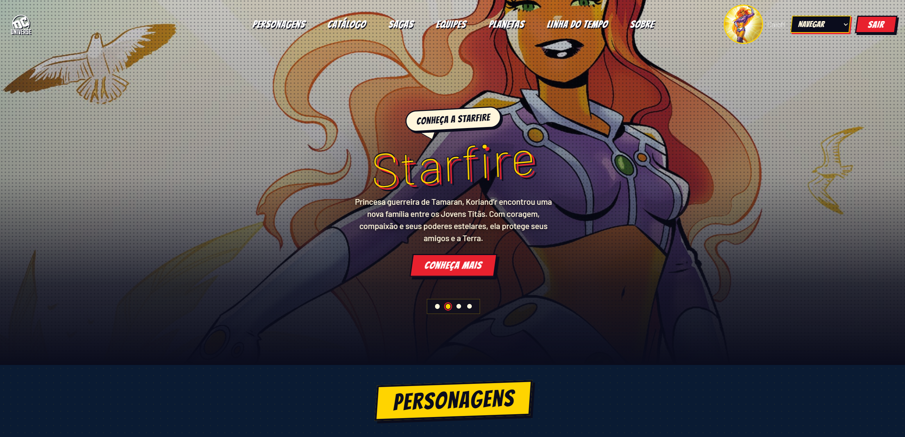
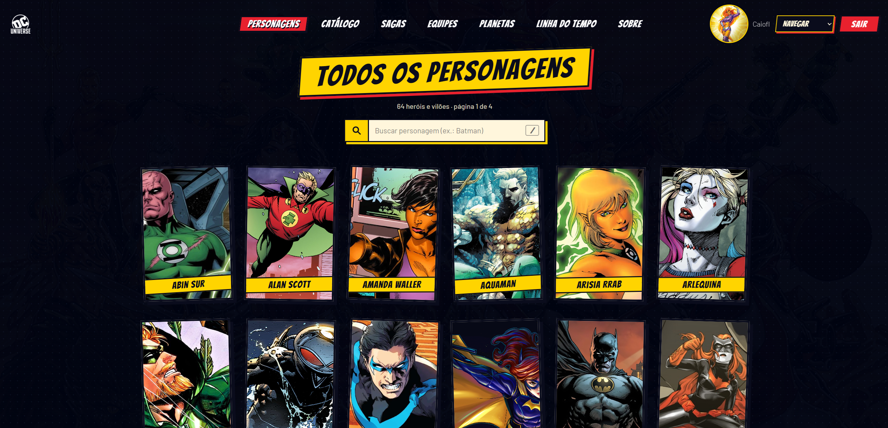
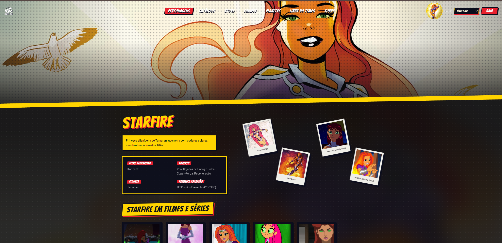
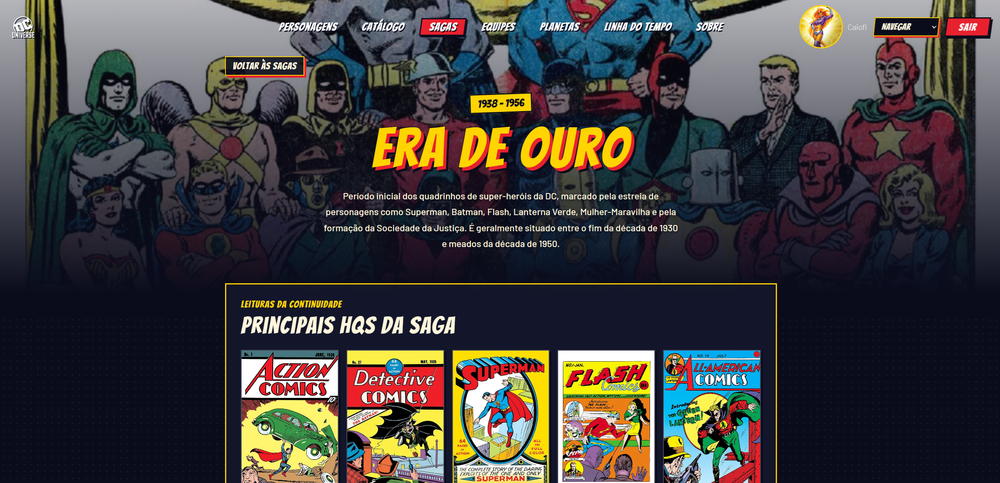
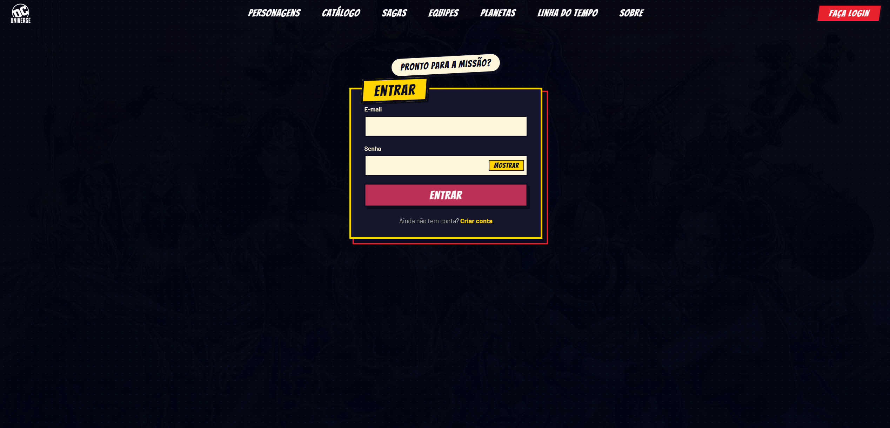
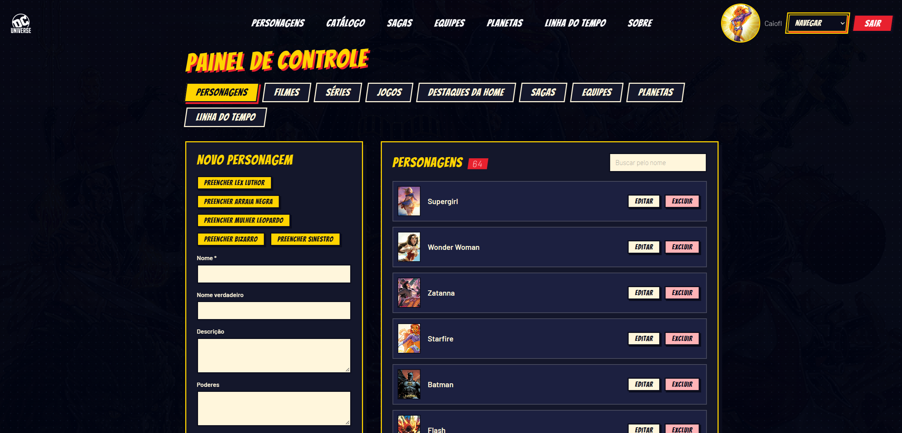
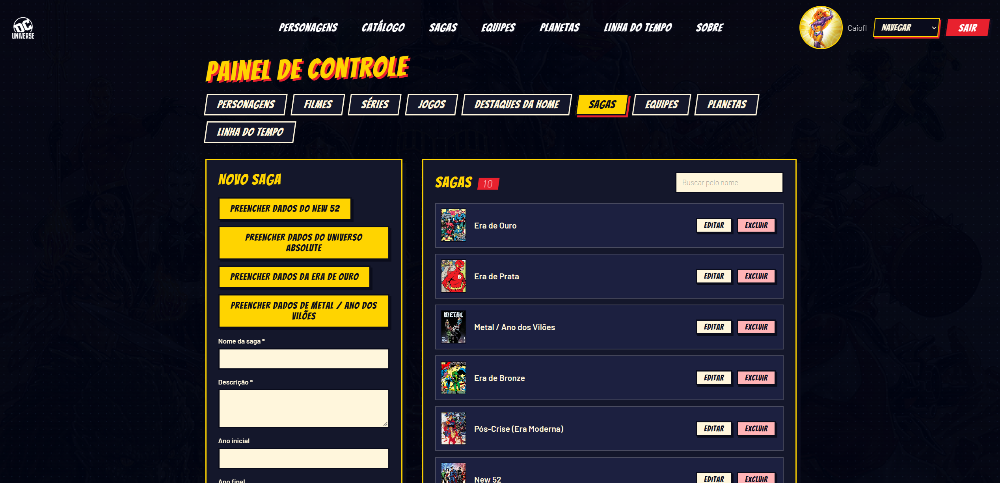
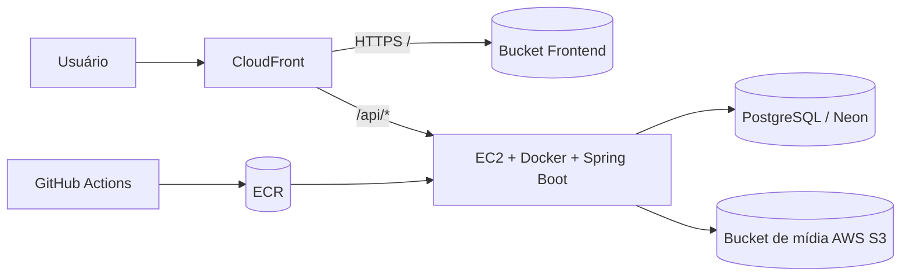
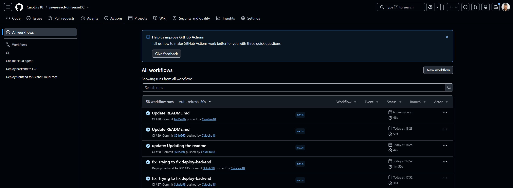

# Universo DC

Aplicação full-stack para catalogar e explorar o universo DC com Java + React, autenticação JWT, upload de arquivos para Amazon S3, painel administrativo e deploy em infraestrutura AWS com CloudFront, EC2 e ECR.

## Visão geral

O projeto reúne uma API REST em Spring Boot e um frontend em React/Vite para disponibilizar:

- catálogo público de personagens, filmes, séries, jogos, grupos, planetas, sagas e linha do tempo;
- páginas de detalhe com imagens, galeria e contextos da narrativa;
- autenticação e perfil de usuário;
- painel administrativo para gerenciar conteúdos e mídias;
- upload de arquivos para o Amazon S3;
- deploy automatizado via GitHub Actions.

## Preview

<p align="center">
  
</p>
<p align="center"><em>Página inicial</em></p>

### Catálogo

<table>
  <tr>
    <td width="50%"></td>
    <td width="50%"></td>
  </tr>
  <tr>
    <td align="center"><em>Listagem com paginação</em></td>
    <td align="center"><em>Detalhe do personagem, com aparições em filmes, séries e jogos</em></td>
  </tr>
  <tr>
    <td width="50%"></td>
    <td width="50%"></td>
  </tr>
  <tr>
    <td align="center"><em>Linha do tempo</em></td>
    <td align="center"><em>Sagas e HQs</em></td>
  </tr>
</table>

### Autenticação

<p align="center">
  
</p>
<p align="center"><em>Login e perfil do usuário</em></p>

### Painel administrativo

<table>
  <tr>
    <td width="50%"></td>
    <td width="50%"></td>
  </tr>
  <tr>
    <td align="center"><em>Cadastro e listagem paginada de personagens</em></td>
    <td align="center"><em>Gerenciamento de sagas e equipes, com upload de mídia para o S3</em></td>
  </tr>
</table>

## Stack tecnológica

| Camada | Tecnologias |
| --- | --- |
| Frontend | React 19, Vite, JavaScript, Node.js 22 |
| Backend | Java 21, Spring Boot 3, Spring Security, Spring Data JPA |
| Banco | PostgreSQL (Neon em produção, Postgres em CI) |
| Armazenamento de mídia | Amazon S3 |
| Infraestrutura | AWS: S3, CloudFront, EC2, ECR, IAM, Systems Manager |
| CI/CD | GitHub Actions |
| Containerização | Docker |

## Funcionalidades principais

- Catálogo completo do universo DC com listagem e paginação por entidade.
- Personagens com aparições em filmes, séries e jogos.
- Galerias de imagens, banners e mídias por item de conteúdo.
- Grupos e equipes com associação de personagens.
- Sagas com HQs e organização cronológica.
- Linha do tempo e destaques da home.
- Sistema de autenticação com JWT para usuários e admin.
- Upload e organização de mídias por bucket S3, por recurso e por usuário.
- Painel administrativo para criar, editar e remover conteúdos protegidos, com listagem paginada e busca por nome.
- Health check da API para deploy seguro em EC2.

## Arquitetura da solução



O fluxo principal é:

- frontend estático entregue pelo CloudFront;
- API Java em EC2;
- banco de dados em PostgreSQL;
- upload de imagens e arquivos em bucket S3 separado;
- GitHub Actions publica a imagem e faz deploy automatizado.

## Estrutura de pastas

```text
.
├── .github/
│   └── workflows/
│       ├── ci.yml
│       ├── deploy-backend.yml
│       └── deploy-frontend.yml
├── .vscode/
├── dc/
│   ├── src/
│   ├── .env.example
│   ├── Dockerfile
│   ├── HELP.md
│   ├── mvnw
│   ├── mvnw.cmd
│   ├── pom.xml
│   └── .mvn/
├── front/
│   ├── src/
│   ├── public/
│   ├── .env.example
│   ├── .env.production
│   ├── Dockerfile
│   ├── nginx.conf
│   ├── package.json
│   ├── package-lock.json
│   ├── vite.config.js
│   └── README.md
├── .gitignore
├── LICENSE
├── README.md
└── .gitattributes
```

## URLs da API e controllers

A API expõe as rotas abaixo no backend. Em produção, a URL pública do backend é normalmente acessada via CloudFront como `https://<dominio-cloudfront>/api`.

Base local de desenvolvimento:

- `http://localhost:8080`

Base em produção:

- `https://<cloudfront-domain>/api`

### Endpoints principais

| Controller | Base path | Descrição |
| --- | --- | --- |
| `UsersController` | `/users` | autenticação, cadastro, perfil e upload de mídia do usuário |
| `CharacterController` | `/characters` | personagens e filtros |
| `CharacterAppearanceController` | `/character-appearances` | aparições de personagens em mídias |
| `MovieController` | `/movies` | filmes |
| `SeriesController` | `/series` | séries |
| `GameController` | `/games` | jogos |
| `CharacterGameAppearanceController` | `/character-game-appearances` | aparições em jogos |
| `PlanetController` | `/planets` | planetas |
| `GroupController` | `/groups` | grupos e equipes |
| `SagaController` | `/sagas` | sagas e histórias |
| `TimelineController` | `/timelines` | linha do tempo |
| `HomeSlideController` | `/home-slides` | destaques da home |
| `CatalogController` | `/catalog` | catálogo centralizado |

### Exemplos de rotas

- `POST /api/users/register`
- `POST /api/users/login`
- `GET /api/users/me`
- `GET /api/characters`
- `GET /api/characters/{id}`
- `GET /api/movies`
- `GET /api/series`
- `GET /api/games`
- `GET /api/planets`
- `GET /api/groups`
- `GET /api/sagas`
- `GET /api/timelines`
- `GET /api/home-slides`
- `GET /api/catalog/page`

Observação importante:

- rotas públicas são acessíveis sem token;
- operações administrativas, perfil do usuário e uploads sensíveis dependem de autenticação JWT;
- a configuração de segurança está em `dc/src/main/java/br/com/caio/dc/Config/SecurityConfig.java`.

## Organização dos buckets de mídia

A aplicação usa buckets S3 separados para manter o frontend e as mídias em isolamento.

### Estrutura sugerida

| Tipo | Caminho no S3 |
| --- | --- |
| Frontend | `dc-frontend-prod/` |
| Mídias | `dc-media-prod/` |
| Usuários | `users/{userId}/` |
| Personagens | `characters/{characterName}/` |
| Filmes | `movies/{movieId}/` |
| Séries | `series/{seriesId}/` |
| Jogos | `games/{gameId}/` |
| Planetas | `planets/{planetId}/` |
| Grupos | `groups/{groupId}/` |
| Sagas | `sagas/{sagaId}/` |
| HQs dentro de saga | `sagas/{sagaId}/comics/{comicId}/` |
| Home slides | `home-slides/{slideId}/` |
| Timeline | `timelines/{timelineId}/` |

Arquitetura recomendada:

- bucket de frontend: apenas conteúdo estático;
- bucket de mídia: uploads do painel e usuários;
- CloudFront diante do frontend e, opcionalmente, do conteúdo público em origin S3;
- organização por recurso para facilitar versionamento, backup e governança.

## Deploy na AWS

### Arquitetura de produção

- Frontend: S3 + CloudFront
- Backend: EC2 + Docker + ECR
- Banco: PostgreSQL (Neon em produção)
- Variáveis de ambiente e segredos: AWS Systems Manager Parameter Store
- CI/CD: GitHub Actions com OIDC para AWS

### Fluxo de deploy

1. O push para `main` dispara os workflows definidos em `.github/workflows/`.
2. O CI valida frontend e backend.
3. Se houve mudança em `front/**`, o workflow `deploy-frontend.yml` faz build do React e sincroniza o bucket S3.
4. Se houve mudança em `dc/**`, o workflow `deploy-backend.yml` faz build da imagem Docker, publica no ECR e atualiza a instância EC2 via SSM.
5. O CloudFront invalida cache para refletir as mudanças do frontend.

### Configuração de produção

As variáveis/segredos esperadas pelos workflows são, em geral:

- `AWS_REGION`
- `AWS_DEPLOY_ROLE_ARN`
- `FRONTEND_BUCKET`
- `CLOUDFRONT_DISTRIBUTION_ID`
- `ECR_REPOSITORY_URL`
- `EC2_INSTANCE_ID`
- `SSM_ENV_PARAMETER`
- `VITE_API_URL`

Esses valores devem ser configurados em:

- GitHub: `Settings > Secrets and variables > Actions > Repository secrets`

Importante:

- nunca comitar chaves de acesso AWS;
- preferir IAM role com OIDC e SSM para segredos sensíveis;
- `VITE_API_URL` deve apontar para o endpoint da API pública, normalmente `https://<cloudfront>/api`.

## Workflows no GitHub

<p align="center">
  
</p>
<p align="center"><em>Pipelines de CI/CD no GitHub Actions</em></p>

### 1) `ci.yml`

Responsável pela validação contínua.

- Trigger: `push` para `main` e `pull_request`
- Valida:
  - instalação e build do frontend;
  - lint do frontend;
  - testes do backend em Java;
  - banco PostgreSQL em container para execução dos testes.

### 2) `deploy-frontend.yml`

Responsável pelo deploy do frontend.

- Trigger: `workflow_dispatch` e `push` em `main` quando há alteração em `front/**`
- Etapas:
  - checkout do código;
  - configuração do Node.js;
  - build do Vite;
  - sincronização com o bucket S3;
  - invalidação do CloudFront.

### 3) `deploy-backend.yml`

Responsável pelo deploy do backend.

- Trigger: `workflow_dispatch` e `push` em `main` quando há alteração em `dc/**`
- Etapas:
  - autenticação AWS via OIDC;
  - login no ECR;
  - build e push da imagem Docker;
  - envio de comando via SSM para a EC2;
  - pull da imagem, execução do container e health check em `/actuator/health`;
  - rollback automático para a imagem anterior em falha.

## Variáveis de ambiente

### Backend (`dc/.env`)

Essenciais:

```env
DB_URL=jdbc:postgresql://host:5432/dc
DB_USERNAME=postgres
DB_PASSWORD=postgres
JWT_SECRET=seu_jwt_secret
JWT_EXPIRATION=86400000
AWS_S3_BUCKET=dc-media-prod
AWS_S3_REGION=us-east-1
AWS_S3_ENDPOINT=
AWS_ACCESS_KEY_ID=
AWS_SECRET_ACCESS_KEY=
JPA_DDL_AUTO=validate
CORS_ALLOWED_ORIGINS=http://localhost:5173,https://<dominio>
```

### Frontend (`front/.env`)

```env
VITE_API_URL=http://localhost:8080
```

No projeto, o frontend lê essa variável em `front/src/config.js` e usa `API_URL` para todas as chamadas da API.

## Executando localmente

### Requisitos

- Java 21
- Node.js 22
- PostgreSQL local ou acessível
- AWS CLI configurado se usar S3 localmente

### Backend

```bash
cd dc
chmod +x mvnw
./mvnw spring-boot:run
```

### Frontend

```bash
cd front
npm install
npm run dev
```

A API fica em `http://localhost:8080` e o frontend em `http://localhost:5173` por padrão.

## Checklist de deploy

Antes da primeira publicação em produção, confirme:

- EC2 registrada no AWS Systems Manager;
- bucket S3 do frontend criado;
- CloudFront configurado com distribuição pública;
- bucket S3 de mídia criado;
- role de deploy com OIDC habilitado;
- ECR repository ativo;
- parameter store com `.env` sensível protegido;
- `VITE_API_URL` apontando para o backend público;
- health check `/actuator/health` respondendo corretamente.

## Licença

Este projeto está disponível sob a licença MIT. Consulte o arquivo `LICENSE` para mais detalhes.
