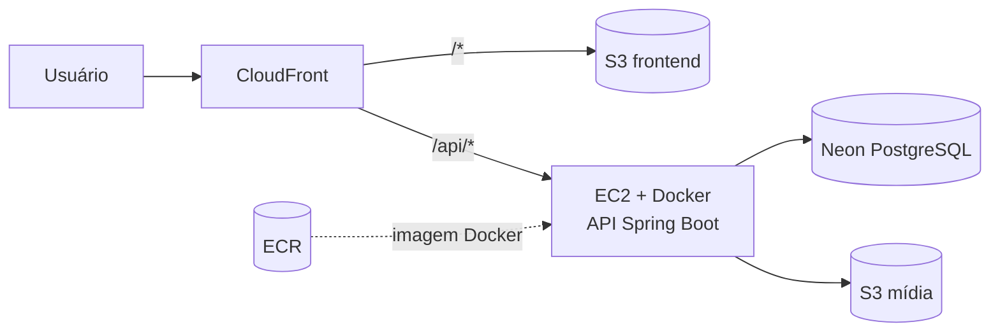

# Universo DC

Enciclopédia do universo DC feita com **Java + React**: personagens, filmes, séries, jogos, planetas, equipes de heróis, sagas e linha do tempo, com painel administrativo, contas de usuário e upload de mídia para o Amazon S3. A aplicação está publicada na AWS, com o banco de dados no Neon.

## Tecnologias

| Camada | Tecnologias |
| --- | --- |
| Frontend | React, Vite, Node.js 22 |
| Backend | Java 21, Spring Boot, Spring Data JPA/Hibernate, autenticação JWT |
| Banco de dados | PostgreSQL (Neon em produção) |
| Armazenamento de mídia | Amazon S3 |
| Infraestrutura | AWS (CloudFront, S3, EC2, ECR, IAM), Docker, Terraform |

## Funcionalidades

- **Catálogo público:** personagens, filmes, séries, jogos, planetas, equipes e sagas, cada um com listagem e página de detalhes.
- **Personagens com aparições:** cada personagem pode ser ligado a filmes, séries e jogos, com uma imagem específica para cada aparição, exibida na página do personagem.
- **Equipes de heróis:** grupos como a Liga da Justiça e os Jovens Titãs, com os personagens que os integram.
- **Sagas e HQs:** sagas como New 52 e Era de Ouro, com as HQs em ordem de leitura, cada uma com ano, descrição e capa.
- **Linha do tempo e destaques:** marcos do universo DC e slides de destaque da página inicial, ordenáveis e publicáveis.
- **Galerias de imagens:** filmes, séries, jogos e planetas têm banner e galeria.
- **Contas de usuário:** cadastro e login com JWT. Cada usuário tem uma pasta própria no S3 para as suas mídias.
- **Painel administrativo:** CRUD completo de todos os conteúdos, com upload de imagens direto para o S3. As operações de escrita exigem autenticação.

## Arquitetura



O frontend e a API ficam atrás do mesmo domínio do CloudFront, o que evita problemas de CORS e de conteúdo misto (HTTP dentro de página HTTPS).

## Como foi feito o deploy

O objetivo foi um deploy **econômico**, sem servidores gerenciados caros, mas com infraestrutura reproduzível e sem segredos no código.

**Frontend: S3 + CloudFront.** O build do React é um conjunto de arquivos estáticos publicado em um bucket S3 privado. O CloudFront entrega o conteúdo por HTTPS e com cache global, e é o único com acesso ao bucket.

**API: EC2 + Docker + ECR.** O backend é empacotado em uma imagem Docker (`dc/Dockerfile`), enviada para o Amazon ECR e executada em uma instância EC2 com reinício automático. O health check é `/actuator/health`.

**Um único domínio para tudo.** O CloudFront encaminha `/api/*` para a EC2 e o restante para o S3 do frontend. Uma CloudFront Function remove o prefixo `/api` antes de repassar a requisição, então a API continua com as rotas originais (`/characters`, `/users/login`, etc.) e o frontend só precisa chamar `/api/...`.

**Banco de dados: Neon PostgreSQL.** O banco é serverless e gerenciado, sem uma instância de banco para operar. A API conecta por JDBC com SSL.

**Mídia em um bucket separado.** As imagens enviadas pelo painel e pelos usuários ficam em um bucket S3 próprio, distinto do bucket do frontend, e organizadas por recurso (veja abaixo). Assim dá para recriar a infraestrutura sem perder as imagens.

**Sem chaves de acesso.**
- A EC2 acessa o ECR e o bucket de mídia por uma **IAM Role** da instância, então não existe access key no código, na imagem Docker ou no GitHub.
- A integração com o GitHub usa **OIDC**, o que permite pipelines sem credenciais fixas.
- Segredos (banco, `JWT_SECRET`) ficam apenas em um arquivo `.env` na EC2. Arquivos `.env`, `terraform.tfvars` e o state do Terraform são ignorados pelo Git.

**Infraestrutura como código.** Tudo isso é criado com Terraform em [`deploy/aws/`](./deploy/aws/): uma VPC pública pequena, EC2, ECR, os buckets, a distribuição CloudFront, o Security Group, as IAM Roles e o OIDC do GitHub.

## Organização das mídias no S3

Cada recurso tem sua pasta, e cada usuário tem uma pasta exclusiva com o seu id:

| Recurso | Pasta no S3 |
| --- | --- |
| Usuários | `users/{userId}/` |
| Personagens | `characters/{nome-do-personagem}/` |
| Aparições em filmes e séries | `movies/{movieId}/{characterId}/` e `series/{seriesId}/{characterId}/` |
| Filmes e séries | `movies/{movieId}/` e `series/{seriesId}/` |
| Jogos e personagens em jogos | `games/{gameId}/` e `games/{gameId}/Personagens/{characterId}/` |
| Planetas | `planets/{planetId}/` |
| Equipes | `groups/{groupId}/` |
| Sagas e HQs | `sagas/{sagaId}/` e `sagas/{sagaId}/comics/{comicId}/` |
| Destaques da Home | `home-slides/{slideId}/` |
| Linha do tempo | `timelines/{timelineId}/` |

Os uploads aceitam arquivos de até 25 MB e são feitos por endpoints autenticados que recebem o arquivo em um campo multipart `file`.

## Executando localmente

Requisitos: Java 21, Node.js 22, PostgreSQL e um bucket S3.

1. Copie `dc/.env.example` para `dc/.env` e preencha o banco e a AWS.
2. No backend (`dc/`), execute `./mvnw spring-boot:run` (no Windows, `.\mvnw.cmd spring-boot:run`).
3. No frontend (`front/`), copie `front/.env.example` para `front/.env` e execute:
   ```bash
   npm install
   npm run dev
   ```

O frontend usa a variável `VITE_API_URL` para localizar a API.

## Estrutura do repositório

```text
.
├── dc/                  # API Spring Boot
├── front/               # Aplicação React/Vite
├── deploy/aws/          # Terraform da infraestrutura
├── .github/workflows/   # CI/CD
└── README.md
```

## Licença

Distribuído sob a licença MIT. Veja o arquivo `LICENSE`.
